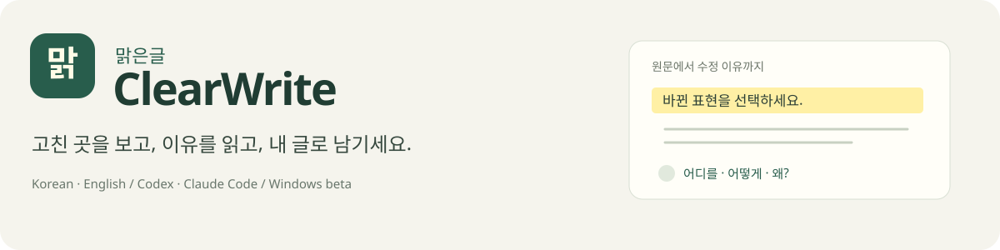
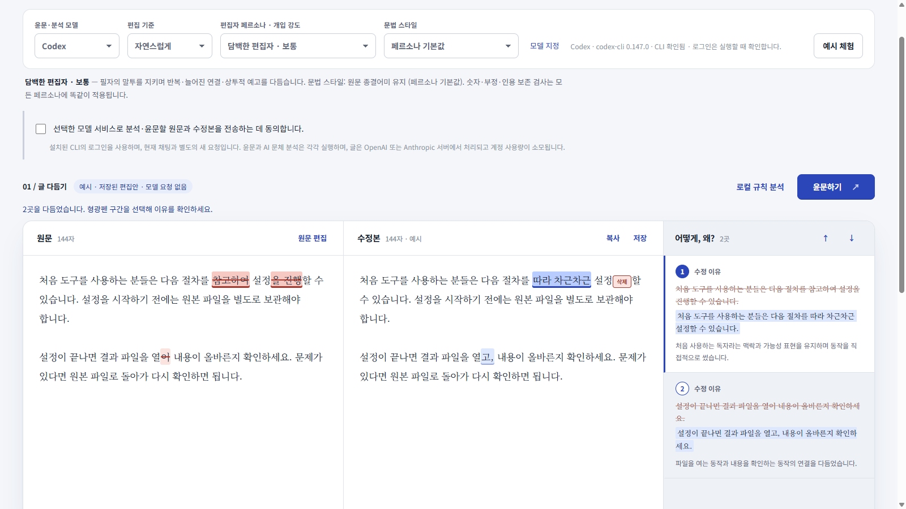

<div align="center">



**어디를 왜 고쳤는지 보여 주는 한국어·영어 윤문 프로그램**

[Windows 베타 다운로드](https://github.com/xoxo787/clearwrite/releases/download/v0.3.1/ClearWrite-0.3.1-Windows-x64.zip) · [사용 설명서](docs/DESKTOP.md) · [English](README.en.md) · [오류 제보](https://github.com/xoxo787/clearwrite/issues)

[](https://github.com/xoxo787/clearwrite/actions/workflows/ci.yml)
[](LICENSE)


</div>

**여러분, 아직도 AI가 써준 글을 그대로 붙여넣고 계신가요?**

겉으로는 매끄러워도 같은 말이 되풀이되는 글이 있습니다. 설명은 길어도 요점은 잘 잡히지 않고, 조금만 손보면 될 것 같은데 어디부터 고쳐야 할지 막막합니다.

이런 불편을 살펴본 연구도 있습니다. 2026년 ACM 학회에 발표된 소규모 탐색 연구에서, 주의집중과 정보처리에 어려움을 겪는 참여자들은 AI 답변의 지나친 길이와 빽빽한 구성을 이용 장벽으로 꼽았습니다. 답변의 분량과 구성을 독자에게 맞출 필요가 있음을 시사합니다. [연구 원문](https://doi.org/10.1145/3803784.3816862)

**그래서 만들었습니다. ClearWrite, 맑은글.**

원문의 뜻과 말투를 살리며, 사람이 읽기 편하도록 문장을 다듬습니다.

다듬은 글은 원문과 직접 비교할 수 있습니다. **형광펜으로 표시된 부분을 누르면, 바꾸기 전 표현과 바꾼 표현, 수정한 이유가 함께 보입니다.** 바뀐 표현이 내 글에 어울리는지 직접 확인하세요.

- **자연스럽게 다듬기:** 어색한 표현과 불필요한 반복을 손질합니다.
- **목적에 맞는 편집:** 필자의 말투 유지, 기술 문서 등 편집 기준을 선택합니다.
- **AI 문체 살펴보기:** 반복·상투적 표현 등을 참고용 점수와 실제 문장 근거로 확인합니다.
- **수정량 확인하기:** 윤문 전후의 글자 차이를 계산해 실제 수정 비율을 보여줍니다.

한국어와 영어를 지원합니다. 설치와 로그인을 마친 **Codex CLI 또는 Claude Code**에 연결해 사용할 수 있습니다. 모델 작업에는 본인 계정의 사용량이 소모됩니다.

**고친 곳을 보고, 이유를 읽고, 내 글로 남기세요.**

[ClearWrite 0.3.1 베타 다운로드](https://github.com/xoxo787/clearwrite/releases/tag/v0.3.1)

*연구 인용은 정보처리에 어려움이 있는 참여자 10명의 소규모 탐색 결과입니다. 모든 AI 글의 피로도나 ClearWrite의 효과를 입증한 결과는 아닙니다. [연구 범위와 출처](docs/promotion-review/README.md#연구-인용의-범위)*

## 이 소개글도 ClearWrite로 다듬었습니다

이 소개글의 원문에 ClearWrite 스킬 0.3.1을 적용했습니다. **AI 문체 자체 평가는 19/100 → 17/100으로 2점 낮아졌고**, 실제 적용된 수정은 **9곳**, 글자 차이로 계산한 **실제 수정 비율은 10.37%**입니다.

19점과 17점은 글을 작성하고 고친 **같은 Codex 대화 모델의 참고용 자체 평가**입니다. 원문과 수정본 모두 AI가 작성한 문장이며, 점수 변화는 AI 생성 확률·작성률이나 탐지 성능의 개선율을 뜻하지 않습니다. 독립 평가와 독자 이해도 검증은 하지 않았습니다.

[윤문 전후·수정 이유·검수 기록 보기](docs/promotion-review/README.md)

> **시작 전에**
>
> Windows 배포판은 Python을 따로 설치하지 않아도 실행할 수 있습니다. 글을 윤문하거나 AI 문체를 분석하려면 **설치와 로그인을 마친 Codex CLI 또는 Claude Code**가 필요합니다. 전송에 동의하면 글이 해당 모델 서비스로 보내지고, 본인 계정의 사용량이 소모됩니다.

## 한눈에 보기



*‘예시 체험’을 눌러 프로그램에 들어 있는 설정 안내문을 편집한 화면입니다. 미리 준비한 수정안을 적용하므로 모델을 호출하지 않습니다. 문체 점수는 AI 문체 분석을 실행한 뒤에 표시됩니다.*

| 기능 | 화면에서 확인하는 것 |
| --- | --- |
| **형광펜 비교** | 추가·수정은 노란색, 삭제·기존 표현은 분홍색과 취소선 |
| **수정 이유** | 바꾸기 전 표현, 바꾼 표현, 수정한 이유를 연결해서 표시 |
| **같은 위치로 이동** | 구간이나 설명을 누르면 원문·수정본·이유 영역을 함께 이동 |
| **AI 문체 분석** | 선택한 Codex·Claude의 문체 점수와 실제 인용 근거 |
| **실제 수정 비율** | 적용된 글자 차이를 계산하고 삭제·추가 글자 수를 표시 |
| **결과 보관** | 수정본 TXT와 원문·편집 내역·문체 평가를 포함한 JSON 저장 |

## 시작하기

### Windows에서 사용하기

1. [Codex CLI](https://developers.openai.com/codex/cli/) 또는 [Claude Code](https://code.claude.com/docs/en/overview)를 설치하고 본인 계정으로 로그인합니다. 데스크톱 앱 로그인만으로 CLI가 준비되지는 않습니다.
2. [Windows x64 ZIP](https://github.com/xoxo787/clearwrite/releases/download/v0.3.1/ClearWrite-0.3.1-Windows-x64.zip)을 내려받아 **전체 압축을 풉니다**.
3. `ClearWrite/ClearWrite.exe`를 실행합니다. `_internal` 폴더는 실행 파일 옆에 그대로 두세요.
4. **예시 체험**을 눌러 수정 표시와 이유를 살펴봅니다. 이 버튼은 모델을 호출하지 않습니다.
5. 글을 입력하고 사용할 모델을 고릅니다. 전송에 동의한 뒤 **윤문하기**를 누릅니다.
6. 문체 점수와 판단 근거를 보려면 다시 전송에 동의한 뒤 **AI 문체 분석**을 누릅니다. 원문과 현재 수정본을 함께 분석하며, 글을 다시 고치지는 않습니다.

프로그램을 실행하면 내 PC 전용 편집 화면이 브라우저에서 열립니다. 사용할 포트는 자동으로 정하므로 웹 서버를 따로 설정할 필요가 없습니다. 결과는 자동으로 보관되지 않으니 필요한 글과 검수 기록을 저장한 뒤 **앱 종료**를 눌러 주세요.

Windows 배포판은 **설치 없이 실행하는 포터블 베타판**이며, 아직 실행 파일에 서명하지 않았습니다. Windows에서 게시자나 평판 관련 경고가 나타날 수 있습니다. 실행이 막히면 보안 기능을 끄지 말고 [사용 설명서](docs/DESKTOP.md)에서 실행 방법과 연결 문제 해결 안내를 확인하세요.

### 소스에서 실행하기

Python 3.10 이상이 필요합니다. 실행에 필요한 외부 Python 패키지는 없습니다.

```sh
git clone https://github.com/xoxo787/clearwrite.git
cd clearwrite
python rewrite.py
```

macOS/Linux에서는 환경에 따라 `python3` 명령을 사용하세요. 운영체제별로 확인한 내용은 아래 검증 표와 [호환성 문서](docs/COMPATIBILITY.md)에서 볼 수 있습니다.

## 점수는 이렇게 읽으세요

### AI 문체 점수: 문체를 살펴보는 참고 점수(0~100)

선택한 Codex·Claude가 다음 네 가지를 각각 0~25점으로 평가합니다.

- 같은 말과 구조의 **반복**
- **상투적인 연결·강조**
- **획일적인 문장 흐름**
- 구체성 없는 **추상적 부연**

점수가 높을수록 이런 문체 특징이 두드러진다는 뜻입니다. 프로그램은 판단 근거로 인용한 문장이 원문이나 수정본에 실제로 있는지 확인합니다. 점수가 정해진 범위에 있고 분석 대상도 현재 글과 일치하는지 검사한 뒤 결과를 표시합니다.

**AI 작성 확률이나 AI가 작성한 비율을 측정하는 기능은 아닙니다.** 사람의 글에도 이런 특징이 있고, AI의 글에도 없을 수 있습니다. 평가의 일관성과 저자 판별 정확도는 검증하지 않았으며, 장르·모델·실행에 따라 결과가 달라질 수 있습니다.

Pangram 같은 별도 탐지 서비스의 API 키는 필요하지 않습니다. 분석에 실패하거나 요청을 취소한 경우, 또는 글이 바뀐 경우에는 이전 점수를 지우고 **미분석**으로 표시합니다.

### 실제 수정 비율: 이번 윤문에서 바뀐 글자의 양

실제로 적용한 수정에서 삭제·추가된 글자 수를 계산합니다.

```text
(삭제·교체된 원문 글자 + 추가·대체된 글자)
────────────────────────────────────────── × 100
          원문 글자 수 + 수정본 글자 수
```

글자 수는 공백과 줄바꿈을 포함한 Unicode 코드포인트를 기준으로 셉니다. 바뀐 내용이 없거나 보존 검사에서 수정이 차단돼 원문을 유지한 경우에는 0%로 표시합니다. 계산에 사용한 글자 수와 식은 검수 JSON에서도 확인할 수 있습니다.

## 뜻과 말투를 살피며 다듬습니다


ClearWrite는 글의 뜻과 말투를 유지하면서 **필요한 만큼 다듬는 것**을 목표로 합니다. 수정안이 가리키는 원문이 맞는지, 숫자·단위·일부 조건 표현이 바뀌지 않았는지 살핍니다. 인용문·코드·보호 용어를 지키고 글이 지나치게 줄어들지 않는지도 검사합니다. 허용된 변경량이나 분량 보존 기준을 넘는 수정안은 차단할 수 있습니다.

이 검사가 모든 의미 변화나 사실 왜곡을 찾아내지는 못합니다. 완성된 글을 원문과 대조해 확인해 주세요. 어떤 기준을 쓰는지와 검사의 한계는 [구조와 판단 기준](docs/ARCHITECTURE.md)에서 볼 수 있습니다.

## 모델 연결과 글의 보관

- Codex·Claude CLI에 로그인한 계정을 사용합니다. ClearWrite는 로그인 파일을 직접 읽거나 복사하지 않습니다.
- 윤문과 문체 분석은 각각 **새로운 모델 요청**이며, 본인 계정의 사용량이 소모됩니다. 현재 채팅의 내용이나 답변을 가져와 재사용하지 않습니다.
- 글 전송에 동의해야 모델을 호출합니다. 편집 화면은 내 PC에서 열리고, 모델 처리는 OpenAI 또는 Anthropic 서비스에서 이뤄집니다.
- **예시 체험 · 로컬 규칙 분석 · 원문 보존**은 모델을 호출하지 않습니다.
- 모델에는 제공한 글만 처리하도록 요청하며 도구·MCP·플러그인을 제한합니다. 시간·출력 한도를 설정하고 취소 기능을 제공합니다.
- 원문과 응답은 프로세스 간 통신으로 주고받으며, ClearWrite는 이를 임시 파일에 쓰지 않습니다. 임시 작업 폴더에는 글이 들어 있지 않은 응답 형식 파일만 둡니다.
- 서버의 완료·실패·취소 기록은 작업이 끝난 뒤 15분이 지나면 새 요청이 없어도 자동으로 지웁니다. 앱을 종료할 때도 정리합니다. 화면에 열어 둔 글과 직접 저장한 파일은 지우지 않습니다.
- 이 처리는 ClearWrite의 새 요청에 적용됩니다. 구버전이 남긴 파일이나 CLI 자체의 캐시·서비스 보관까지 삭제하지는 않습니다.
- 직접 저장한 검수 JSON에는 원문이 포함됩니다. 파일은 암호화하지 않으므로 보관하거나 공유할 때 내용을 확인하세요.

전송·저장 범위는 [보안 문서](SECURITY.md)에서 확인할 수 있습니다.

## CLI와 Codex 스킬

```sh
# 로그인된 Codex CLI로 윤문
python rewrite.py rewrite input.txt --backend codex --allow-model -o edited.txt --report report.json

# 원문과 수정본의 문체를 함께 평가
python rewrite.py detect input.txt --provider codex --candidate edited.txt --allow-model -o style.json

# 모델 요청 없이 로컬 규칙으로 편집 후보 분석
python rewrite.py analyze input.txt

# Codex 스킬 설치 계획 확인 → 적용
python scripts/install_codex.py --kind skill
python scripts/install_codex.py --kind skill --apply
```

스킬을 설치한 뒤 새 Codex 세션에서 `$clearwrite`로 호출할 수 있습니다. 스킬은 해당 세션의 모델로 작동하고, 독립 프로그램은 PC에 설치된 CLI로 새 요청을 보냅니다. 자세한 차이와 명령은 [CLI·스킬 안내](docs/CLI.md)에서 확인하세요.

## 검증한 내용과 남은 한계

| 항목 | 확인 상태 |
| --- | --- |
| Windows x64 포터블 EXE | 실행·중복 실행 재사용·종료 확인 |
| Codex CLI 0.147.0 | 실제 윤문·문체 분석 연결 확인 |
| Claude Code | 모의 프로세스·응답 규약 검사 완료, 실제 호출 미검증 |
| 로컬 자동 검사 | Windows / Python 3.13.14에서 223개 실행, 221개 통과·2개 생략 |
| 브라우저 화면 | 형광펜·수정 이유·점수·다운로드·실패·취소·입력 변경·반응형 검사 |
| Python wheel | 새 가상 환경에서 오프라인 설치·CLI 실행 확인 |
| GitHub Actions | Ubuntu·Windows·macOS / Python 3.10~3.13의 12개 조합 통과 |
| AI 저자 판별 정확도 · 독자 이해도 개선 | 검증하지 않음 |

자동 검사는 실제 모델을 호출하지 않습니다. 실제 모델 연결 검사와 모의 응답 검사를 구분해 적었습니다. 최신 자동 검사 결과는 상단 배지와 [Actions](https://github.com/xoxo787/clearwrite/actions)에서 확인하세요.

## 개발과 기여

```sh
python scripts/build_bundles.py
python -m unittest discover -s tests -v
python scripts/benchmark.py --out reports/reproduced
```

`src/clearwrite`가 원본 코드입니다. 이 코드를 수정한 뒤 생성기로 스킬·플러그인 내부 복사본을 동기화합니다. 실행에는 Python 표준 라이브러리만 사용합니다. Windows 실행 파일을 직접 빌드하려면 [빌드 안내](docs/CLI.md#windows-실행-파일-빌드)를 참고하세요.

오류를 발견하면 OS와 프로그램 버전, 재현 방법, 개인정보를 뺀 예문을 [Issues](https://github.com/xoxo787/clearwrite/issues)에 남겨 주세요. 개인 원문이나 API 키가 들어 있지 않은지 확인한 뒤 올려 주세요. [기여 안내](CONTRIBUTING.md) · [변경 기록](CHANGELOG.md) · [평가 방법](docs/EVALUATION.md)

## 라이선스와 출처

ClearWrite의 코드와 문서는 [MIT License](LICENSE)로 배포합니다. 재사용·번안한 코드의 저작권 고지는 유지합니다. 비교·평가에 쓴 자료는 각 출처의 라이선스를 따릅니다.

[재사용·저작권 고지](THIRD_PARTY_NOTICES.md) · [개별 라이선스](licenses/) · [자료 출처](data/NOTICE.md)
